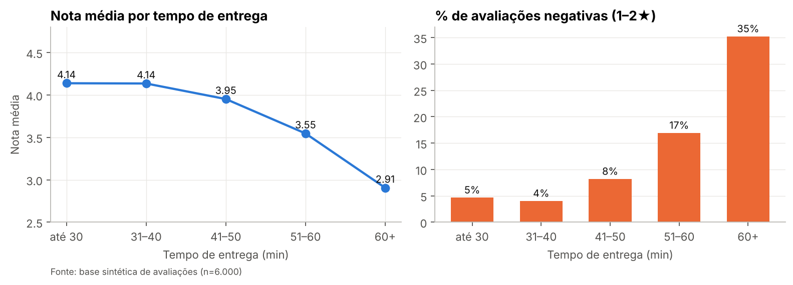
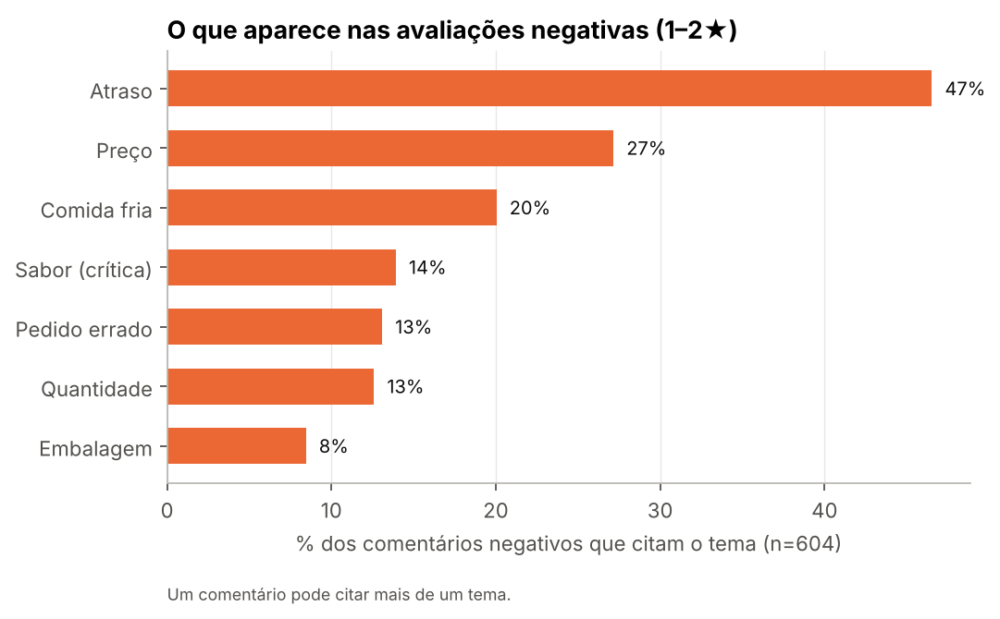
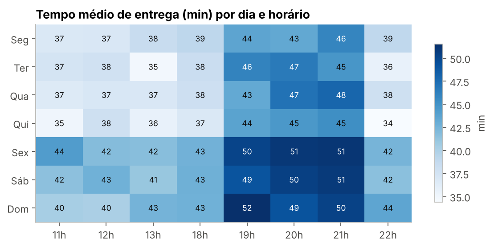

# 🔍 Análise de Dados – Comentários de Restaurantes

Projeto em Python de **limpeza, análise exploratória e extração de insights** a partir de avaliações de restaurantes de delivery (nota de 1 a 5 + comentário em texto livre).

A pergunta central: **o que realmente derruba a nota de um pedido — e onde agir primeiro?**

> ⚠️ **Sobre os dados:** a base é **sintética**, gerada por `src/gerar_dados.py`. Ela imita o formato e os problemas típicos de uma base real de avaliações (duplicatas, datas em 3 formatos, 24 grafias para 7 categorias, notas fora da escala, tempos de entrega impossíveis). Nenhum dado é de clientes, restaurantes ou plataformas reais. O objetivo é demonstrar o **método**, que se aplica diretamente a dados reais.

---

## 📌 Principais insights



| # | Insight | Ação sugerida |
|---|---|---|
| 1 | A nota fica estável (~4,1) até **40 min** de entrega. Acima de **60 min**, as avaliações negativas sobem de ~5% para **35%** | Usar "% de pedidos acima de 50 min" como indicador de risco |
| 2 | O tempo médio passa de **50 min** no pico de **sexta a domingo, 19h–21h** (vs. ~40 min no resto da semana/dia) | Reforço de entregadores ou tempo prometido mais realista nesses horários |
| 3 | **Atraso** aparece em 47% dos comentários negativos; **comida fria** (efeito colateral da demora) em 20% | Priorizar logística antes de cardápio |
| 4 | **31% das avaliações de 4★** trazem uma crítica no texto | Analisar o texto, não só a nota |
| 5 | Além do preço (queixa comum), os restaurantes com mais notas ruins têm **dores diferentes**: pedido errado, sabor ou atraso | Feedback personalizado ao parceiro, gerado a partir dos temas |

<table>
<tr>
<td></td>
<td></td>
</tr>
</table>

---

## 🧹 Limpeza de dados

Toda a limpeza fica em `src/limpeza.py`, que devolve a base limpa **e** um log de cada etapa (`reports/qualidade_dados.csv`):

| Problema encontrado | Linhas | Decisão |
|---|---:|---|
| Avaliações duplicadas | 180 | removidas |
| Categoria escrita de 24 jeitos (`sushi`, `Comida Japonesa`, `PIZZA`…) | 4.317 | mapeadas para 7 categorias |
| Cidade/restaurante com espaços e caixa diferentes | 494 / 300 | grafia mais frequente como padrão |
| Datas em 3 formatos (`2026-01-03 19:54`, `03/01/2026 19:54`, `03/01/26`) | 6.000 | convertidas; formato sem hora → hora nula |
| Notas 0, 6, 10 | 25 | anuladas (fora da escala 1–5) |
| Valor como texto (`R$ 27,67`) | 892 | convertido para número |
| Tempo de entrega -5, 0, 999 min | 38 | anulado (fora de 5–180 min) |
| Comentário `"ok"`, `"-"`, `"."` | 75 | anulado |

**Por que anular em vez de apagar a linha?** Uma avaliação com tempo de entrega errado ainda tem nota e comentário válidos. Apagar a linha inteira jogaria fora informação boa.

---

## 💬 Temas dos comentários

Os comentários são normalizados (minúsculas, sem acento, sem emoji) e classificados por **regras de palavras-chave** em 7 temas de crítica: atraso, comida fria, pedido errado, embalagem, preço, quantidade e sabor.

Cuidado com **falsos positivos**: "veio tudo bem embalado, *sem vazar*" e "*preço justo*" são elogios — regras ingênuas (`vaz`, `preco`) contariam como reclamação. As regras finais foram validadas contra todas as frases da base (0 erros).

### Com GenAI (opcional)
Regras não pegam ironia, gíria ou erro de digitação ("veio um gelo", "nunca mais peço"). O script `src/temas_llm.py` classifica uma amostra com um LLM (API da Anthropic), pede a resposta em JSON e mede a **concordância com as regras**, salvando as divergências para revisão manual. É o caminho para escalar a análise para textos reais.

---

## 🗂️ Estrutura

```
analise-comentarios-restaurantes/
├── data/
│   ├── raw/avaliacoes_raw.csv            # base bruta (6.180 linhas)
│   └── processed/avaliacoes_limpas.csv   # base limpa (6.000 linhas, 17 colunas)
├── notebooks/
│   └── analise_comentarios.ipynb         # análise completa, narrada e executada
├── src/
│   ├── gerar_dados.py                    # gera a base sintética (seed fixa)
│   ├── limpeza.py                        # pipeline de limpeza + log de qualidade
│   ├── analise.py                        # temas, gráficos e números-chave
│   └── temas_llm.py                      # (opcional) classificação com LLM
├── figures/                              # 6 gráficos usados no notebook e no README
├── reports/
│   ├── qualidade_dados.csv               # log da limpeza
│   ├── insights.json                     # números-chave calculados
│   └── dores_top5_restaurantes.csv
└── requirements.txt
```

## ▶️ Como rodar

```bash
pip install -r requirements.txt
python src/gerar_dados.py     # gera data/raw/
python src/limpeza.py         # gera data/processed/ e reports/qualidade_dados.csv
python src/analise.py         # gera figures/ e reports/insights.json
jupyter notebook notebooks/analise_comentarios.ipynb
```

A seed é fixa, então os números do README são reproduzidos exatamente.

## 🛠️ Ferramentas

Python · pandas · NumPy · Matplotlib · Jupyter · regex/NLP básico · API de LLM (opcional)

## ⚖️ Limitações

- **Dados sintéticos:** os padrões foram embutidos para exercitar o método; dados reais são mais ruidosos.
- **Correlação ≠ causalidade:** restaurantes lentos podem ser piores em outras coisas. Um teste A/B no tempo prometido mediria o efeito real.
- **Regras de texto** são uma linha de base transparente, não o teto — daí o script com LLM.

---

**Luiza Miller** · [LinkedIn](https://linkedin.com/in/luiza-miller) · [GitHub](https://github.com/Luizamiller)
